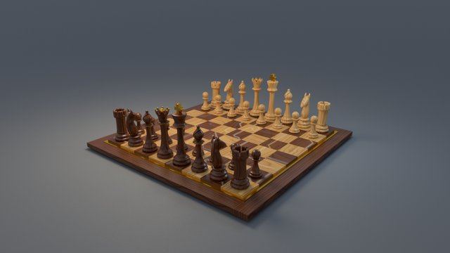
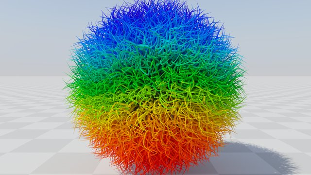
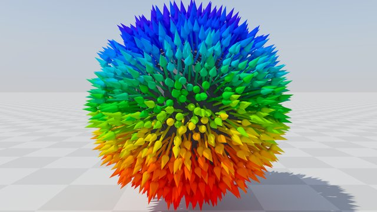
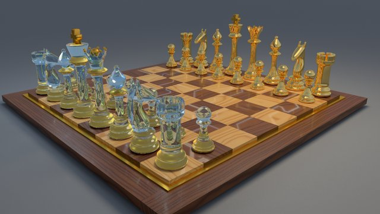
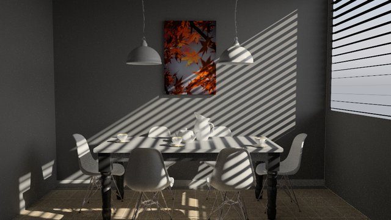
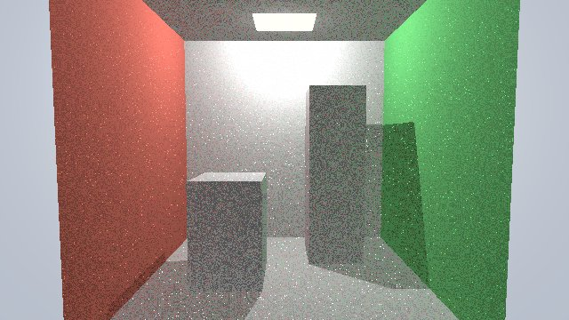
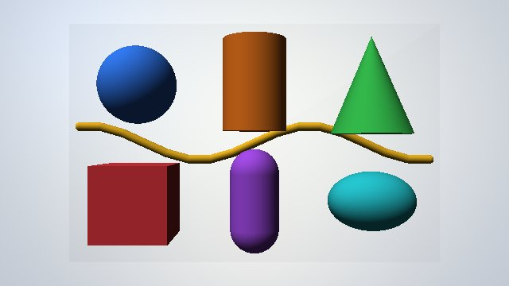
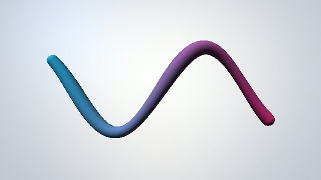
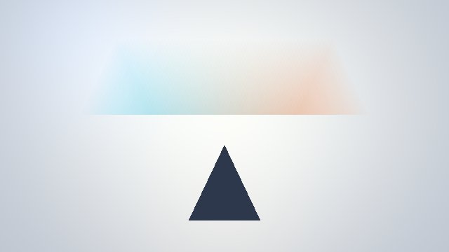

# Examples

Run from the repository root after installing the example dependencies:

```bash
uv sync --extra pathtracing --extra ui --extra usd
# or: pip install -e ".[pathtracing,ui,usd]"
```

## Path tracing

`example_pathtracing.py` opens an interactive viewer (WASD to move, drag to look).

<table>
  <tr>
    <td width="33%" align="center"><a href="example_pathtracing.py"></a><br><code>--scene chess</code></td>
    <td width="33%" align="center"><a href="example_pathtracing.py"></a><br><code>--scene hairball</code></td>
    <td width="33%" align="center"><a href="example_pathtracing.py"></a><br><code>--scene arrowball</code></td>
  </tr>
  <tr>
    <td width="33%" align="center"><a href="example_pathtracing.py"></a><br><code>--scene glass_chess</code></td>
    <td width="33%" align="center"><a href="example_pathtracing.py"></a><br><code>--scene glass_of_water</code></td>
    <td width="33%" align="center"><a href="example_pathtracing.py"></a><br><code>--scene breakfast_room</code></td>
  </tr>
</table>

```bash
uv run python examples/example_pathtracing.py --scene chess           # procedural chess set
uv run python examples/example_pathtracing.py --scene hairball        # cubic Bézier curves
uv run python examples/example_pathtracing.py --scene arrowball       # ArrowBatch curve arrows
uv run python examples/example_pathtracing.py --scene contact_lines   # 100k OpenGL lines over the frame
uv run python examples/example_pathtracing.py --scene glass_chess     # glass and gold pieces
uv run python examples/example_pathtracing.py --scene glass_of_water  # downloaded on first use (CC0)
uv run python examples/example_pathtracing.py --scene breakfast_room  # downloaded on first use (CC BY 3.0)
uv run python examples/example_pathtracing.py --gltf scene.glb        # or --usd scene.usd
```

`glass_of_water` and `breakfast_room` are downloaded from Benedikt Bitterli's
[rendering resources](https://benedikt-bitterli.me/resources/) into `~/.cache/warp-optix/scenes` (`WARP_OPTIX_CACHE` overrides the cache root):
*Glass of Water* by aXel (CC0) and *The Breakfast Room* by Wig42
([CC BY 3.0](https://creativecommons.org/licenses/by/3.0/)).

Image credits and rendering details are in [docs/images/README.md](../docs/images/README.md).

Common options: `--width`, `--height`, `--denoiser {auto,optix,none}`, `--exposure`,
`--max-frames N`, `--screenshot out.png`. Run with `--help` for per-scene options.

### Procedural material gallery

[`example_material_gallery.py`](example_material_gallery.py) shows 45
representative materials on procedural shader balls over a checkerboard floor.
The path tracer uses neutral sky and directional lighting so you can compare
the highlights and surface detail.

```bash
uv run --extra pathtracing python examples/example_material_gallery.py
uv run --extra pathtracing python examples/example_material_gallery.py --all-materials --page 2 --output materials.png
uv run --extra pathtracing python examples/example_material_gallery.py --plastics
```

Press **Left** or **Right** to browse the full library, **V** for a new seeded
variation, and **R** to return to the reference fit. Use `--page` and `--seed`
to start at a particular page or variation. Add `--single` to inspect one
material at a time at a larger scale. Use **WASD** to fly, **Q/E** to move down
or up, left-drag to look, the mouse wheel to zoom, and **Home** to reset the view.
The grid bakes at 1024×1024 and single-material view at 2048×2048 by default.
For a 4K close-up, try `--single --texture-size 4096 --filter WoodFloor071`.
Use `--filter WoodFloor` to browse all wood flooring materials together.
Default wheels generate their entire catalog from procedural recipes.
The checkout also includes the fitted catalog. Build with
`--config-setting=cmake.define.WARP_OPTIX_FULL_MATERIAL_CATALOG=ON` to bundle it
in a wheel.

## Ray tracing with the core API

These write a BMP image (`--output`); `example_raytracing.py --live` opens a viewer.

<table>
  <tr>
    <td width="33%" align="center"><a href="example_raytracing.py"></a><br><code>example_raytracing.py</code></td>
    <td width="33%" align="center"><a href="example_mixed_geometry.py"></a><br><code>example_mixed_geometry.py</code></td>
    <td width="33%" align="center"><a href="example_curves.py"></a><br><code>example_curves.py</code></td>
  </tr>
  <tr>
    <td width="33%" align="center"><a href="example_motion_blur.py"></a><br><code>example_motion_blur.py</code></td>
    <td width="33%"></td>
    <td width="33%"></td>
  </tr>
</table>

| Example | Shows |
| --- | --- |
| [`example_minimal.py`](example_minimal.py) | Smallest pipeline: Warp kernels as raygen and miss programs |
| [`example_raytracing.py`](example_raytracing.py) | Cornell box with diffuse global illumination |
| [`example_mixed_geometry.py`](example_mixed_geometry.py) | Triangles, curves and custom primitives under GPU-written instances |
| [`example_curves.py`](example_curves.py) | Built-in round-linear curves with varying width |
| [`example_motion_blur.py`](example_motion_blur.py) | Vertex motion blur with a two-key motion GAS |

```bash
uv run python examples/example_raytracing.py --live
```

## Dynamic OptiX clusters

[`example_clusters.py`](example_clusters.py) generates an animated parametric knot
in Warp and rebuilds real CLAS/GAS with the reusable `ClusterAccel` API. It is
written for this project and needs no downloaded assets, geometry library, or
additional build step. The scene uses a teal metallic material, large soft lights,
reflections and ground shadows. Pausing the animation accumulates samples.

```bash
python examples/example_clusters.py --live
python examples/example_clusters.py --live --view clusters
python examples/example_clusters.py --samples 64 --animate 0 --output clusters.bmp
```

Drag to orbit, scroll to dolly, Space to pause/refine, V to cycle shaded/cluster/
normal views, and +/- to change tessellation. `--along`, `--around`, and
`--cluster-size` control the grid decomposition; `--truncate` exercises position
quantization. The knot is evaluated on the GPU every frame. `ClusterAccel` owns
templates, argument packing and acceleration buffers. The floor is intersected
analytically; shadow and visibility rays traverse the actual cluster geometry.

[`example_deforming_objects.py`](example_deforming_objects.py) updates many
independently deforming bodies and traces one verification ray per body. Use
`clusters` for separate GASes built in one batch. The per-GAS cluster counts stay
fixed while vertices, grid dimensions and offsets can change in place. Use
`triangles` to combine fixed triangle topology in one OptiX refit, or `warp` for
one grouped Warp mesh refit with body-local queries. Group bodies by update rate
if some move much less often, and rebuild refitted trees if traversal degrades.

```bash
python examples/example_deforming_objects.py --mode clusters --bodies 1000
python examples/example_deforming_objects.py --mode triangles --bodies 1000
python examples/example_deforming_objects.py --mode warp --bodies 1000
```

## Neural texture compression

[`neural_texture/`](neural_texture/README.md) trains a compressed neural texture with
warp-nn and evaluates it with OptiX cooperative vectors:

```bash
uv run --extra training python examples/neural_texture/compress.py --output material.wnt
```
