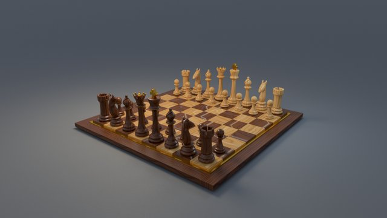
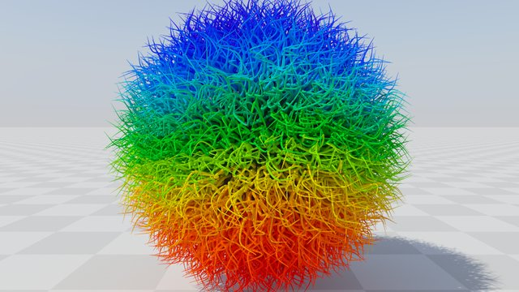
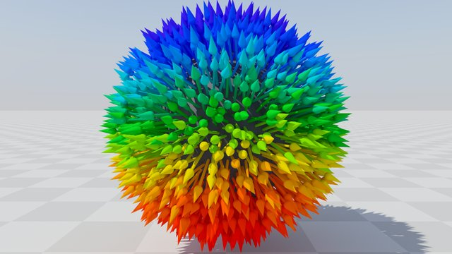
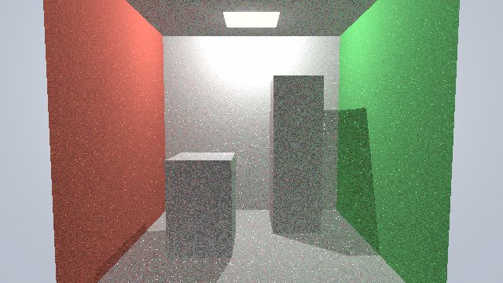
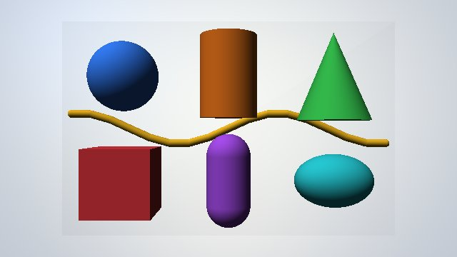
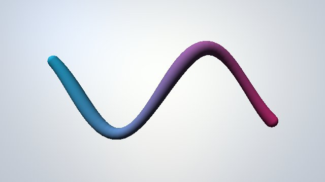

# Examples

Run from the repository root after installing the example dependencies:

```bash
uv sync --extra pathtracing --extra ui --extra usd
# or: pip install -e ".[pathtracing,ui,usd]"
```

## Path tracing

`example_pathtracing.py` opens an interactive viewer (WASD to move, drag to look).

<table>
  <tr>
    <td width="33%" align="center"><a href="example_pathtracing.py"></a><br><code>--scene chess</code></td>
    <td width="33%" align="center"><a href="example_pathtracing.py"></a><br><code>--scene hairball</code></td>
    <td width="33%" align="center"><a href="example_pathtracing.py"></a><br><code>--scene arrowball</code></td>
  </tr>
</table>

```bash
uv run python examples/example_pathtracing.py --scene chess          # procedural chess set
uv run python examples/example_pathtracing.py --scene hairball       # cubic Bézier curves
uv run python examples/example_pathtracing.py --scene arrowball      # ArrowBatch curve arrows
uv run python examples/example_pathtracing.py --scene contact_lines  # 100k OpenGL lines over the frame
uv run python examples/example_pathtracing.py --gltf scene.glb       # or --usd scene.usd
```

Common options: `--width`, `--height`, `--denoiser {auto,optix,none}`, `--exposure`,
`--max-frames N`, `--screenshot out.png`. Run with `--help` for per-scene options.

## Ray tracing with the core API

These write a BMP image (`--output`); `example_raytracing.py --live` opens a viewer.

<table>
  <tr>
    <td width="33%" align="center"><a href="example_raytracing.py"></a><br><code>example_raytracing.py</code></td>
    <td width="33%" align="center"><a href="example_mixed_geometry.py"></a><br><code>example_mixed_geometry.py</code></td>
    <td width="33%" align="center"><a href="example_curves.py"></a><br><code>example_curves.py</code></td>
  </tr>
  <tr>
    <td width="33%" align="center"><a href="example_motion_blur.py"></a><br><code>example_motion_blur.py</code></td>
    <td width="33%"></td>
    <td width="33%"></td>
  </tr>
</table>

| Example | Shows |
| --- | --- |
| [`example_minimal.py`](example_minimal.py) | Smallest pipeline: Warp kernels as raygen and miss programs |
| [`example_raytracing.py`](example_raytracing.py) | Cornell box with diffuse global illumination |
| [`example_mixed_geometry.py`](example_mixed_geometry.py) | Triangles, curves and custom primitives under GPU-written instances |
| [`example_curves.py`](example_curves.py) | Built-in round-linear curves with varying width |
| [`example_motion_blur.py`](example_motion_blur.py) | Vertex motion blur with a two-key motion GAS |

```bash
uv run python examples/example_raytracing.py --live
```

## Neural texture compression

[`neural_texture/`](neural_texture/README.md) trains a compressed neural texture with
warp-nn and evaluates it with OptiX cooperative vectors:

```bash
uv run --extra training python examples/neural_texture/compress.py --output material.wnt
```
